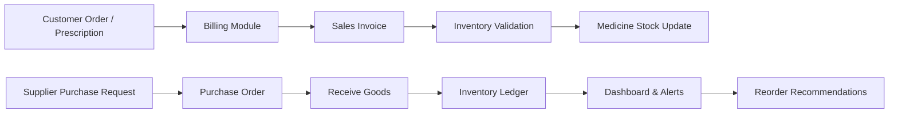
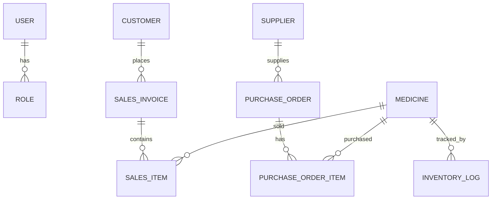

# Pharmacy Management Architecture

## End-to-end workflow

## System components

- React frontend for operations, dashboard, and workflows
- Spring Boot backend for business logic and API layers
- PostgreSQL for transactional inventory and billing history
- JWT security for protected admin and pharmacy staff workflows
- Docker compose for local infrastructure setup

## Core data model

## Security model

- Role-based access for pharmacists, admins, and staff
- JWT bearer tokens for all secured API calls
- Password hashing with BCrypt
- HTTPS and environment variables for secrets
- Audit-friendly transaction tracking in the database
